# User manual

The same guide as the in-app manual. Open it from the product name at the bottom of the sidebar.

## Contents

1. [Getting started](#1-getting-started)
2. [Work items board](#2-work-items-board)
3. [Issue details](#3-issue-details)
4. [Assigning work](#4-assigning-work)
5. [Project plan and Gantt](#5-project-plan-and-gantt)
6. [Initiatives and cycles](#6-initiatives-and-cycles)
7. [Dashboards](#7-dashboards)
8. [AI agents](#8-ai-agents)
9. [Groups](#9-groups)
10. [Project settings](#10-project-settings)
11. [Import and export](#11-import-and-export)
12. [Members, roles and notifications](#12-members-roles-and-notifications)
13. [Connecting AI clients](#13-connecting-ai-clients)
14. [Account and security](#14-account-and-security)
15. [Getting help and admin notes](#15-getting-help-and-admin-notes)

## 1. Getting started

Sign in once and everything below is a click away. You need an account on this instance, created by an invite or by sign-up.

- Sign in with your email or username and password, or press Sign in with passkey to use your fingerprint, face, or device PIN. You can add a passkey later under your account.
- The sidebar on the left lists Inbox, Dashboards, Work items, Initiatives, Cycles, Docs and Notes, then AI Team and Configuration. The project switcher at the top changes team and project. The panel button in the top bar collapses the sidebar.
- Press ⌘K (Ctrl+K on Windows and Linux) to open the command palette. Type to jump to an issue, a page, or a setting, or to run an action such as creating an issue.
- The top bar also holds the plus button to create an issue, the language switcher, and the light or dark theme toggle. Your choices are saved with your account.
- Open this manual again at any time from the product name at the bottom of the sidebar.

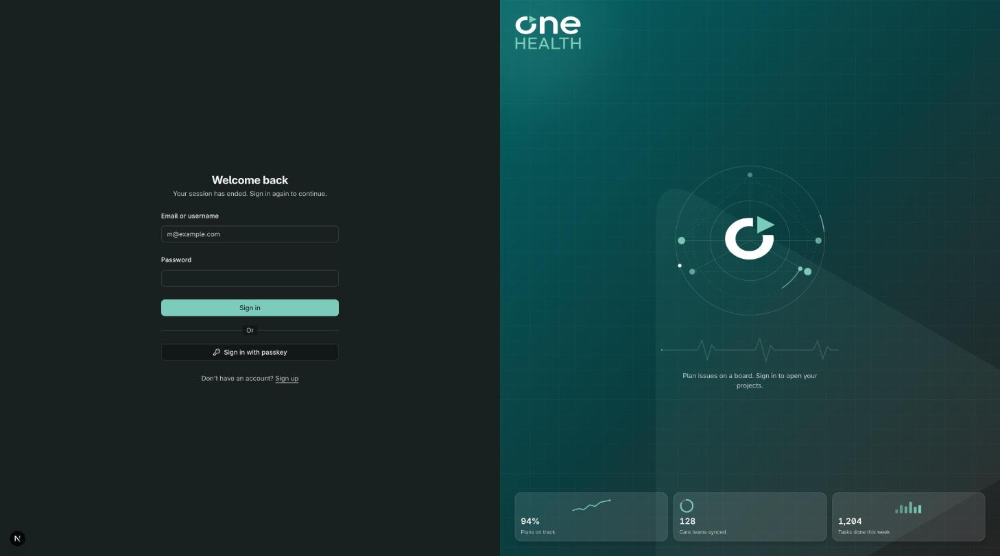

## 2. Work items board

Work items is where the team tracks tasks, requests, incidents, and anything else that needs an owner. The default view is a board.

- Each column is a state, such as Backlog, Todo, In Progress, or Done. Drag a card to another column to change its state. The number next to the column name counts its issues.
- A card shows the key, title, priority, estimate, due date, labels, and the assignee. Click a card to open the issue. The plus button in a column header creates an issue in that state.
- To create an issue, press the plus button in the top bar, or use the command palette. Pick a template, such as Incident report or Supply request, to start from a filled-in description and properties.
- Use the filter button at the right of the tabs to narrow the board by state, assignee, label, priority, and more. The display button changes the layout, grouping, and which properties cards show.
- Save a set of filters and display options as a view with New view. Views are tabs next to All, such as Project plan, and each keeps its own settings.

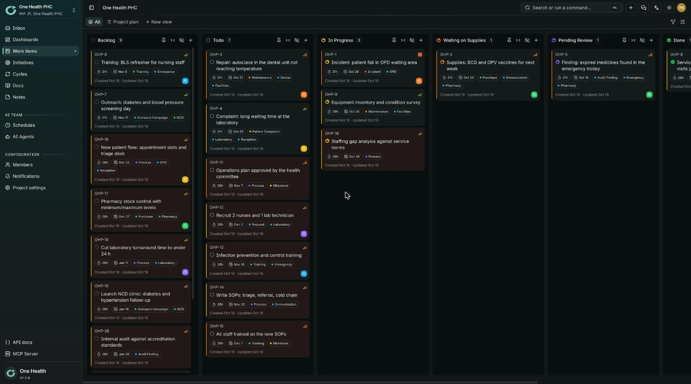

## 3. Issue details

Click any card to open the issue in a side panel. Use the expand button to open it full width.

- The title and description are editable in place. Write what happened, what was done, and what comes next. Checklists and formatting are supported.
- The Properties list holds state, priority, type, assignee, delegate, watchers, initiative, cycle, start and due dates, and labels. Click a value to change it.
- Custom fields appear below the properties, for example Site, Patient Impact, or Patient Safety Incident. Fill them in like any other property.
- Add subtasks to split the work, and links to relate issues: blocks, is blocked by, relates to, or duplicates. A blocking link also draws a dependency arrow in the project plan.
- Write comments at the bottom, reply in threads, attach files, and @mention a person or an AI agent. Press Watch to follow an issue and get notified about comments and state changes.

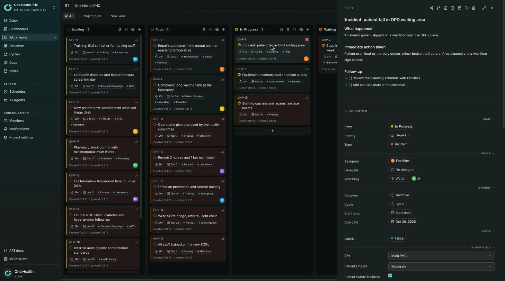

## 4. Assigning work

Every issue can have a person, a group, and a delegate. Assign early so nothing sits without an owner.

- Click the Assignee value in the issue panel and pick a person or a group. Members are listed first, groups below them. Everyone in a group is notified.
- Delegate hands the work to an AI agent while you stay the owner. Pick an agent under Delegate, or @mention it in a comment. The agent reports back on the issue.
- To assign many issues at once, select cards or rows and use the bulk bar that appears at the bottom to set the assignee, state, labels, or priority.
- A project action can assign automatically when an issue moves into a state, for example to the Pharmacy group when it enters Waiting on Supplies. Set it up in Project settings under Actions.
- To see your own work, add the filter Assigned to with the value Me, or Me or my groups to include issues of the groups you belong to. Save it as a view for a daily to-do list.

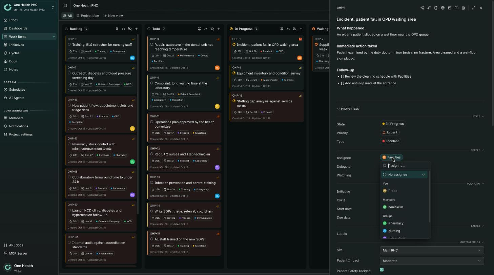

## 5. Project plan and Gantt

The Project plan view lays issues out on a timeline so the team can see sequence, overlap, and delays. Open it from the tabs above the board.

- Issues are rows and time runs across. A bar spans the start date and the due date, so set both on an issue to see it drawn. The thin vertical line marks today.
- Rows are grouped by initiative, so each initiative reads as a phase. Issues without an initiative are listed first. Click the arrow on a group to fold it.
- Arrows connect an issue that blocks another to the issue it blocks. A bar drawn in red stripes starts before the work it depends on has finished: move it later or fix the dates.
- A diamond is a milestone, an issue that is a single point in time such as an approval. Its label sits beside it.
- Drag a bar to move an issue, and drag either end to change its start or due date. Changes are saved straight away.

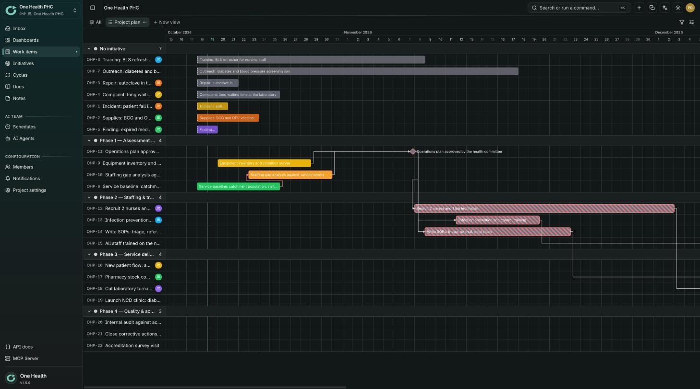

## 6. Initiatives and cycles

Initiatives group issues into larger goals or phases. Cycles time-box the work into a fixed period.

- Open Initiatives to see all of them in tabs: Active, Planned, Proposed, Completed, and All. Each row shows the owner, target date, progress, and health.
- Press New initiative, then give it a name, owner, and target date. Add issues to it from the Initiative property on the issue.
- Progress counts finished issues against the total. Health shows whether the initiative is on track.
- Cycles are short periods, such as two weeks, with a set of issues to finish. Open Cycles in the sidebar to create one and add issues to it.
- Issues still open when a cycle ends move to the next cycle, so nothing is lost.

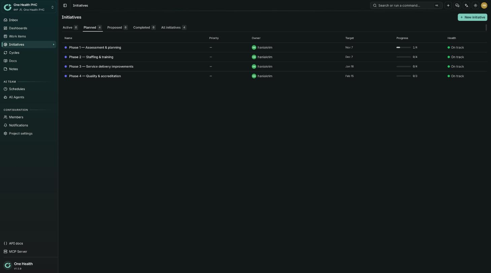

## 7. Dashboards

Dashboards turn the project into numbers that are easy to scan in a meeting or at the start of a shift.

- The Overview dashboard shows tiles for Open, In progress, Backlog, and Unassigned issues, then charts such as Throughput, Breakdown, Pulse, Recent issues, and the Activity feed.
- Check Unassigned first: it counts open issues nobody owns. Open counts everything not done or canceled.
- Press Edit layout to add, remove, resize, and move widgets. Press New dashboard to make another one, for example one per service.
- The Breakdown widget can count issues by state, priority, assignee, label, or group.
- Dashboards update as the team works, so there is nothing to refresh.

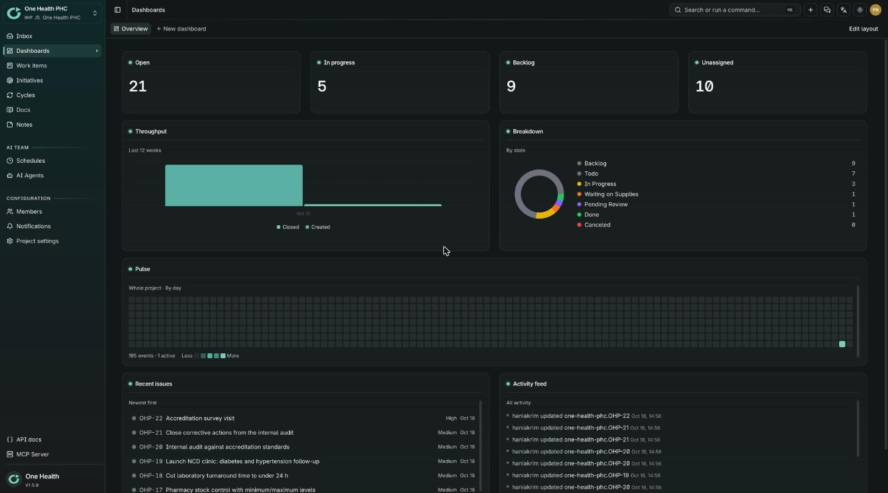

## 8. AI agents

An AI agent is a teammate that works on issues for you: it reads the issue, does the task, and writes the result back as a comment. It has a handle such as @planner or @reviewer.

- Mention an agent with @ in a comment to ask it something, or pick it under Delegate on an issue to hand the work over. Agents also run on schedules, listed under Schedules.
- Some agent actions need a person to approve them first. Approval requests appear on the issue and in your inbox. Every action an agent takes is written to its action log.
- Each agent has a model, a set of tools, and optional budgets that limit how much it can spend. A run stops when the budget is reached.
- Team managers create and edit agents under Manage teams, AI Team, AI Agents. Integrations there connect the agent to a model provider and to other services.
- Treat an agent like a new colleague: give it a clear request, check its result, and keep sensitive decisions with a person.

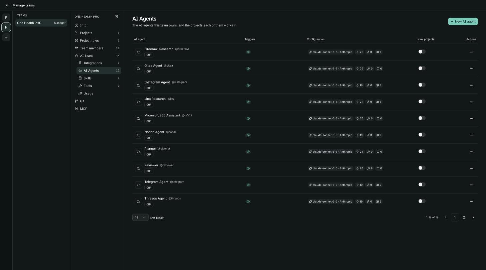

## 9. Groups

A group is a named set of project members, such as Pharmacy, Nursing, Laboratory, Facilities, or Reception. Assign an issue to the group when the team, not one person, owns it.

- Open Project settings, then Groups. Press Add group, choose a name and a color, and pick its members. Only members of the project can join a group.
- Use the pencil icon to rename a group or change its members, and the bin icon to delete it. Deleting a group clears it from its issues.
- Groups appear in the assignee picker below the members, as a chip on cards, as a filter, and as a grouping on the board.
- Every member of a group is notified when an issue is assigned to it, except the person who made the change.
- The Issues column shows how many issues each group holds, which helps spot an overloaded team.

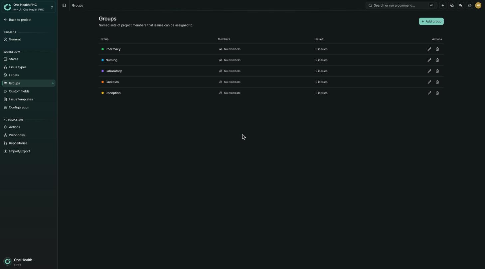

## 10. Project settings

Project settings shape how your team works. Open it from the sidebar. You need manager rights in the project to change it.

- States are the columns of the board, in categories from Backlog to Completed and Canceled. Add, rename, recolor, and drag states to reorder them. Issue types, such as Incident or Request, and labels are managed the same way.
- Custom fields add your own properties to issues: text, number, checkbox, select, or member. A field can apply to every issue or to one issue type only.
- Issue templates are presets for a new issue with its title, description, and properties already filled in. They suit repeated work such as incident reports and supply requests.
- Actions are one-click or automatic changes on an issue, for example set the state and the assignee together. Webhooks send events to another system when issues change.
- Configuration turns features on and off for the project, and General holds its name and key.

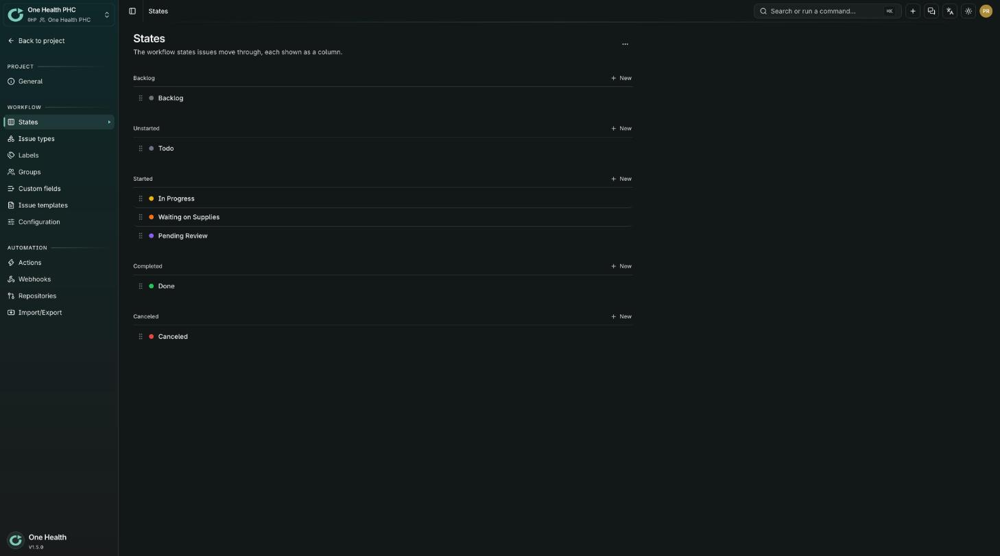

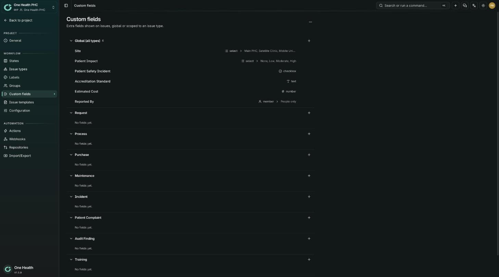

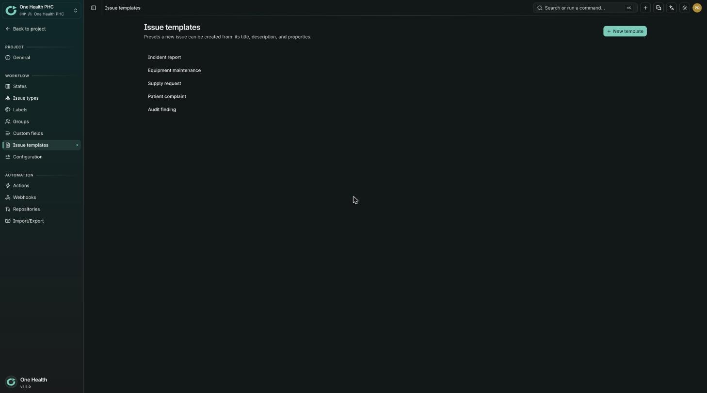

## 11. Import and export

Bring existing work in from another tool, or take a copy of the project out. Open Project settings, then Import/Export.

- Choose a source tab: Plane, Linear, Jira, Trello, Procore, or MS Project. Each tab asks for the address and a token or a file, and has a Test connection step.
- For MS Project, upload the project saved as XML. Tasks become issues, and task links become dependencies.
- Imports run in the background and are listed under Import jobs. A job can be paused, resumed, or canceled while it runs.
- The Export tab downloads the project as a JSON file with its issues, comments, and labels. Keep a copy before a big change.
- Import into a test project first, check the result, and then repeat in the real one.

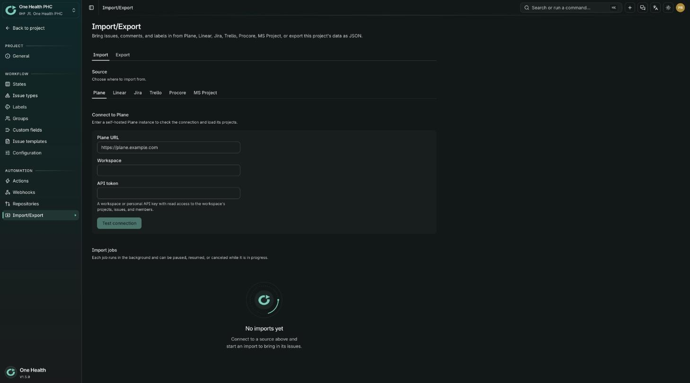

## 12. Members, roles and notifications

Members are the people and AI agents with access to a project. Their role decides what they can change.

- Open Members in the sidebar to see everyone, with tabs for People and AI agents. Add member invites a person or adds an agent.
- The role dropdown sets what a member can do. A role says, for each kind of item, whether its holder can create, edit, read, and delete. Roles are defined by the team managers under Manage teams, Project roles.
- Open Notifications to choose which events reach you and where: assigned to an issue, mentioned, new comment on an issue you watch, and state change on an issue you watch.
- Tick Email, Telegram, or both for each event, then press Save.
- Ask a project owner or team manager if you need a different role.

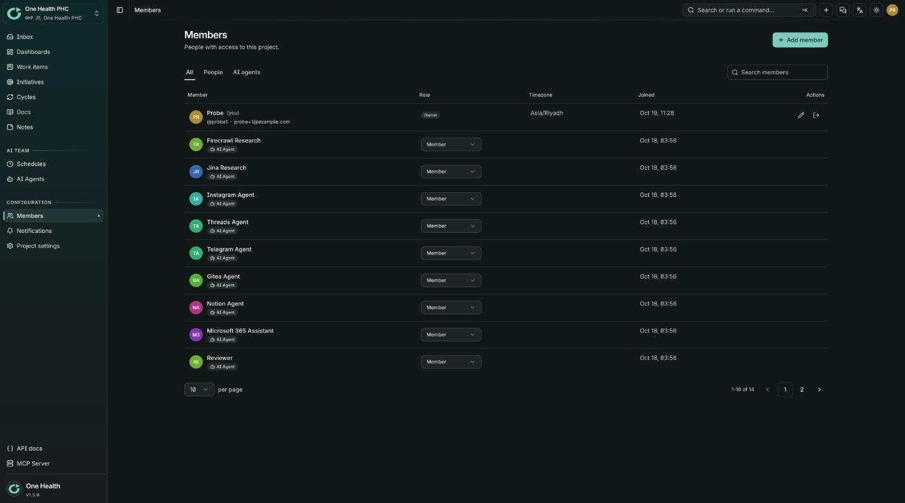

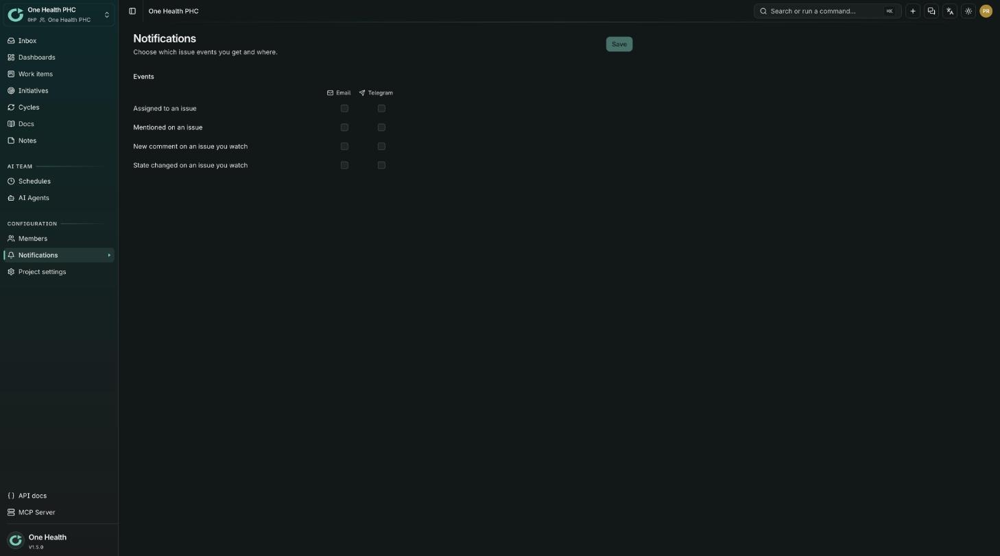

## 13. Connecting AI clients

The MCP server lets an AI client such as Claude or ChatGPT read and update issues on your behalf. Open MCP Server in the sidebar.

- The page shows the MCP endpoint, which is your instance address followed by /mcp, and the OAuth discovery address. Use the copy buttons.
- With OAuth, add an MCP app in your client, paste the endpoint, choose OAuth, then sign in and approve access. The client never receives an API key.
- For Claude Code, run this command, replacing ORIGIN with your instance address: `claude mcp add --transport http plan ORIGIN/mcp`
- With an API key, create a key under your account, open the API key tab, and give the client the key as shown there. The client sees only what that key allows.
- You can revoke a connected app or an API key at any time under your account.

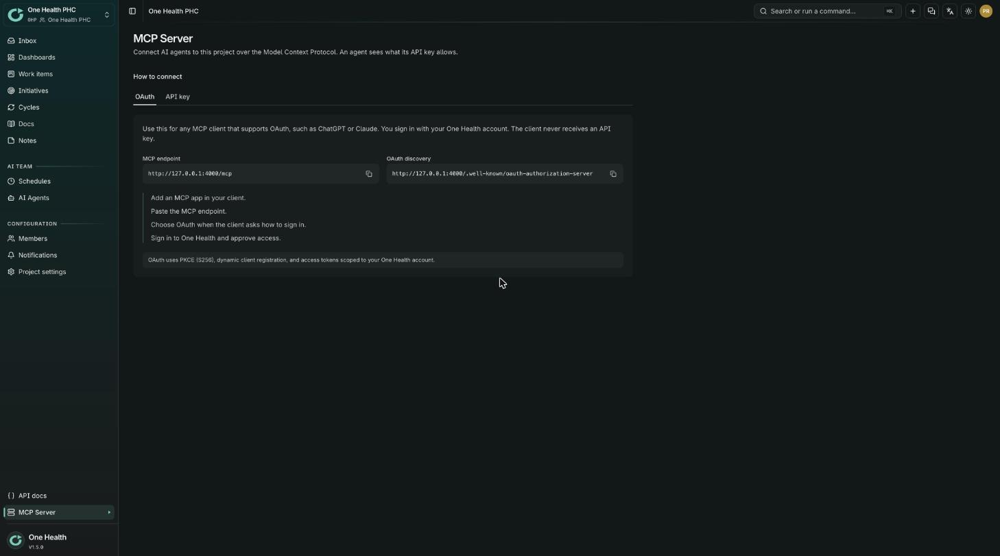

## 14. Account and security

Your account settings are under your avatar at the top right of the screen.

- Profile holds your name, username, avatar, language, and time zone.
- Passkeys let you sign in without a password. Add one on each device you use, and remove one if a device is lost.
- API keys give scripts and AI clients access as you. Give each key a clear name, and delete the ones you no longer use.
- Connected apps lists the apps you approved through OAuth, such as an AI client. Revoke any you do not recognize.
- Sign out from the avatar menu when you use a shared computer.

## 15. Getting help and admin notes

Start with your team: a project manager or a colleague can answer most questions about how your clinic uses the tool.

- If something does not work as described here, tell your project owner or the person who runs this instance, and say which page you were on.
- The API docs link at the bottom of the sidebar opens the technical reference for developers.
- The instance owner has God mode, a separate area for instance-wide settings such as sign-in methods, email, and registration.
- The instance owner is also told when a new version is available. The Release history link in the left column of this manual lists the release notes and checks for updates.
- Back up before updating. The instance takes a database backup automatically before each upgrade.
